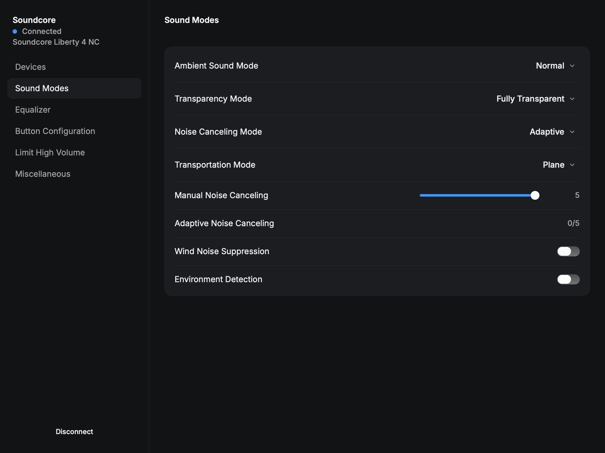
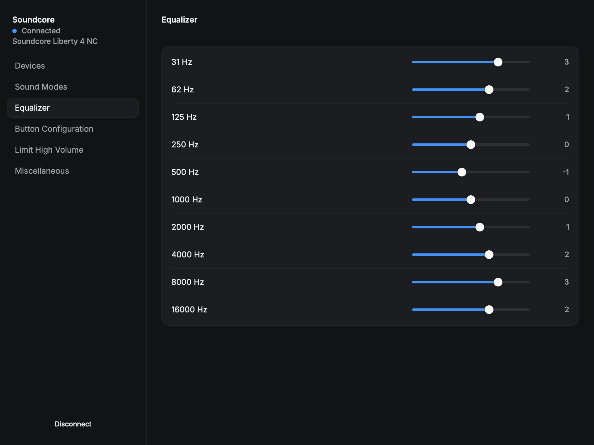
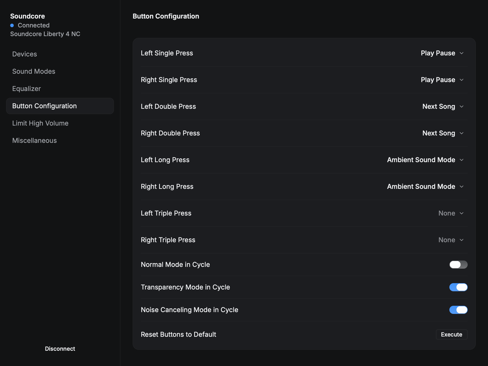
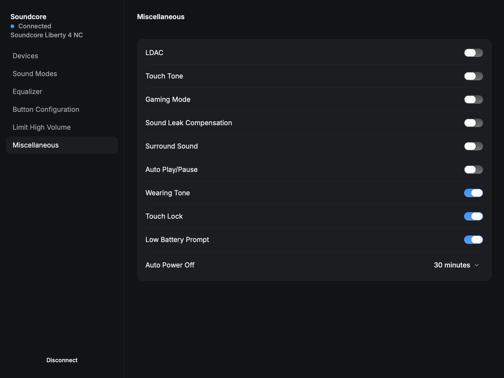

# rune-soundcore

A macOS app for configuring Soundcore earbuds — the settings the phone app gives you, on the
Mac. Built with [Rune](https://github.com/anomalyco/rune) for the UI.

Tested with **Soundcore Liberty 4 NC (A3947)**. Any device OpenSCQ30 supports works if you pick
its model on the Devices page.

## What it does

- Connects over Bluetooth RFCOMM (IOBluetooth) to the earbuds the Mac is already paired with.
- Reads the device's settings and renders a page per category:
  - **Sound Modes** — ambient/ANC/transparency mode, transportation mode, manual and adaptive
    noise cancelling, wind noise suppression, environment detection.
  - **Equalizer** — preset profiles and per-band adjustments (only while both earbuds are
    connected to each other; the device reports "Both earbuds must be connected" otherwise).
  - **Button Configuration** — every press gesture per earbud, ANC cycle contents, reset.
  - **Limit High Volume**, **Miscellaneous** (LDAC, gaming mode, in-ear detection, touch lock,
    auto power off, …), **Device Information** (serial, firmware, TWS status, battery).
- Writes changes back as you make them and follows changes the device pushes.

Not included in v1: EQ profile import/export, quick presets, firmware updates, account features.

## Screenshots

Rendered from a sample snapshot with `just screenshots`, so no real device data.

| | |
|---|---|
|  |  |
|  |  |

## Run it

```sh
cargo run            # from source
just bundle          # build dist/Soundcore.app (ad-hoc signed)
open dist/Soundcore.app
```

Pair the earbuds in System Settings → Bluetooth first. Then open the app, choose the model, press
**Scan**, and pick the earbuds from the list — that pairing is remembered and reconnected on
launch. ⌘R re-reads the device, ⌘Q quits.

## How it is put together

```
src/main.rs        Rune app bootstrap, key handling
src/state.rs       UI state, device snapshot, drafts for in-flight slider drags
src/bt.rs          Bluetooth worker thread: session, connect, watch, write
src/ui/mod.rs      Window shell, sidebar, theme
src/ui/pages.rs    Devices page and the generic per-category settings renderer
src/ui/controls.rs Reusable rows: toggle, slider, information, sections
```

- **UI** — Rune (`rune`, `rune-kit`), pinned to a `dev` rev. macOS native window, wgpu, no webview.
- **Bluetooth + protocol** — [`openscq30-lib`](https://github.com/Oppzippy/OpenSCQ30) pinned to
  PR [#372](https://github.com/Oppzippy/OpenSCQ30/pull/372)'s head, which adds the macOS
  IOBluetooth `RfcommBackend` that upstream does not ship yet.
- **Threading** — one worker thread owns a tokio runtime and the `OpenSCQ30Session`; the UI talks
  to it through an unbounded channel of commands and receives snapshots back through
  `AppHandle::update`, Rune's cross-thread state update. Nothing blocks the main thread.

Settings and pairings live in `~/Library/Application Support/rune-soundcore/soundcore.sqlite3`.

## Development

```sh
just check                         # fmt, clippy, tests
just probe                         # connect, dump every setting, quit
RUNE_SOUNDCORE_PROBE_WRITE=1 just probe   # also toggle one setting and restore it
just snap                          # headless PNG of the UI
```

`RUNE_SOUNDCORE_SNAPSHOT=<file.json> RUNE_SOUNDCORE_PAGE=<category>` renders a page from a saved
snapshot without hardware; `--probe` writes one to
`~/Library/Application Support/rune-soundcore/snapshot.json`.

## Credits

- **[OpenSCQ30](https://github.com/Oppzippy/OpenSCQ30)** by Oppzippy and contributors — the device
  models, Bluetooth protocol and settings definitions this app is built on. Essentially all the
  device knowledge here comes from it. GPL-3.0-or-later.
- **[OpenSCQ30 PR #372](https://github.com/Oppzippy/OpenSCQ30/pull/372)** by
  [SeanathanVT](https://github.com/SeanathanVT) — the macOS IOBluetooth RFCOMM backend, used
  through their fork ([SeanathanVT/OpenSCQ30](https://github.com/SeanathanVT/OpenSCQ30), pinned in
  `Cargo.toml`). Upstream does not ship it yet.
- **[Rune](https://github.com/anomalyco/rune)** by Anomaly — the UI framework (`rune`, `rune-kit`),
  also the source of the vendored `winit`/`wgpu-hal` patches. MIT.
- **Soundcore** and **Liberty** are trademarks of Anker Innovations. This is an unofficial app, not
  affiliated with or endorsed by Anker.

## Licence

Copyright (C) 2026 the rune-soundcore authors. GPL-3.0-or-later. The app links `openscq30-lib`,
which is GPL-3.0-or-later. The app icon (`bundle/icon.png`, `bundle/AppIcon.icns`) is original
artwork under the same licence.

The vendored patch crates are repeated in `Cargo.toml` because a dependency's `[patch]` does not
apply to the workspace that depends on it.
